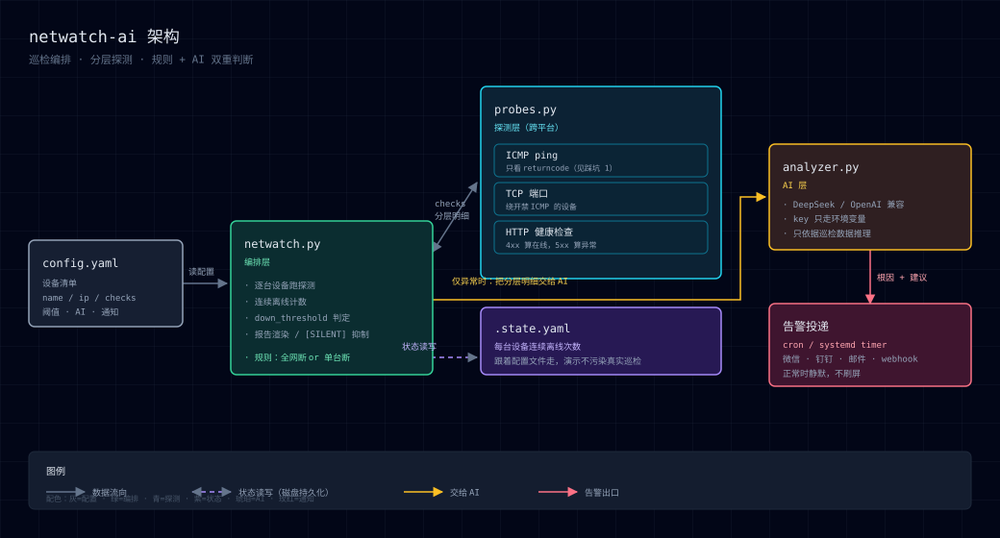

# netwatch-ai 🛰️

**网络巡检 + AI 告警**：定时巡检局域网设备 → **分层探测**（ICMP / TCP 端口 / HTTP）定位到底哪一层断了 → 规则先判断影响面，AI 再说清根因 → 只在真出事时通知你。

[](https://github.com/zhong5666/netwatch-ai/actions/workflows/ci.yml)


---

## 它解决什么

网络运维最烦的不是"设备挂了"，而是**挂了没人知道**，以及**知道挂了但不知道挂在哪**。

普通 ping 脚本只能告诉你「不通」，而这三种情况的处理方式完全不同：

| 现象 | 真实原因 | 该怎么查 |
|---|---|---|
| ICMP 不通 | 设备宕机 / 断网 | 电源、网线、交换机端口 |
| ICMP 通，TCP 端口不通 | 设备活着，服务没起 | 登录设备看服务进程 |
| ICMP 通，HTTP 返回 500 | 设备和服务都在，程序自己报错 | 看应用日志 |

netwatch-ai 把这三层分开探，**每个设备的明细都留在报告里**，再交给大模型说清根因和第一步该干什么。

## 效果（真实终端输出）

来自 `demo/sample_output.txt`（不是示意图，是实际跑出来的）：本地 8899 服务被 kill 掉之后，同一个脚本再跑一次 ——

```text
=== netwatch-ai 巡检报告 2026-10-17 16:19:14 ===
✓ localhost          127.0.0.1   在线 (连续离线 0 次)
      └ ICMP 通 (1022ms)
⚠️ local-web          127.0.0.1   离线 (连续离线 1 次)
      └ ICMP 通 (1024ms) | TCP 8899 连不上 (timed out) | HTTP 连不上 (<urlopen error [WinError 10061] 由于目标计算机积极拒绝，无法连接。>)
⚠️ unreachable-demo   192.0.2.1   离线 (连续离线 2 次)
      └ ICMP 不通 (rc=1)

⚠️ 发现 2 台异常设备: local-web, unreachable-demo

🧭 影响面判断:
规则判断：**多台不可达**（共 2 台）→ 优先怀疑共同上级（交换机/网关/VLAN）。

🤖 AI 分析:
故障类型：local-web 为端口/服务异常；unreachable-demo 为设备宕机或网络中断。
原因：local-web ICMP通但TCP 8899拒绝，疑似服务未启动或防火墙拦截；unreachable-demo ICMP不通，疑似设备离线或链路故障。
修复建议：先检查local-web 8899端口监听及进程状态，再排查unreachable-demo的物理链路与设备状态。
```

（另见 `demo/sample_output.txt`：同一脚本在服务正常 / 服务被 kill 两种状态下的完整对比输出。）

注意 `local-web` 那一行：**ICMP 通、TCP/HTTP 不通** —— 一眼就知道是服务挂了而不是设备失联。

## 架构



```
probes.py     探测层：ICMP / TCP / HTTP，跨平台（Windows/Linux/macOS 参数差异都在这里消化）
netwatch.py   编排层：设备清单、连续离线计数、阈值判定、报告渲染
analyzer.py   AI 层：规则先判影响面，再让大模型说根因（key 只走环境变量）
```

## 快速开始

```bash
git clone https://github.com/zhong5666/netwatch-ai.git
cd netwatch-ai
pip install -r requirements.txt

cp config.example.yaml config.yaml     # 改成你自己的设备清单
python netwatch.py --config config.yaml
```

想立刻看效果（用演示配置，不需要任何真实设备）：

```bash
python -m http.server 8899 &                              # 起个本地服务
python netwatch.py --config demo/config.demo.yaml          # 127.0.0.1 在线 / 192.0.2.1 必然离线
```

想开 AI 分析：

```bash
export NETWATCH_API_KEY=sk-xxxx                            # 只走环境变量，不写进文件
python netwatch.py --config config.yaml --ai
```

默认走 DeepSeek 的 OpenAI 兼容接口，任何兼容端点都能换：

```bash
export NETWATCH_API_BASE=https://api.deepseek.com/v1       # 或你的中转 / 自建网关
export NETWATCH_MODEL=deepseek-chat
```

## 配置说明

```yaml
devices:
  - name: router
    ip: 192.168.1.1
    checks: [icmp]                                        # 不写 checks 时默认就是 [icmp]

  - name: nas
    ip: 192.168.1.10
    checks: [icmp, tcp:22, http://192.168.1.10:5000/health]   # 全部通过才算在线

  - name: cloud-vm
    ip: 10.0.0.8
    checks: [tcp:22]                                      # 云主机禁 ICMP → 只探端口

check:
  ping_count: 3          # 每次 ping 几个包
  ping_timeout: 1        # 单包超时(秒)
  tcp_timeout: 2         # TCP 连接超时(秒)
  http_timeout: 3        # HTTP 请求超时(秒)
  down_threshold: 2      # 连续 N 轮离线才算异常（抗网络抖动）

ai:
  enabled: true
```

| checks 写法 | 含义 |
|---|---|
| `icmp` | ping |
| `tcp:22` | TCP 端口能否建立连接 |
| `http://ip:port/path` | HTTP 有没有响应（4xx 算在线，5xx 算异常） |

多个 check 是 **AND** 语义：任意一项失败即判该设备异常，但**明细全部保留**。

## 接入定时任务

```bash
*/5 * * * * cd /opt/netwatch-ai && NETWATCH_API_KEY=sk-xxx /usr/bin/python3 netwatch.py --ai --silent-ok
```

`--silent-ok` 是给定时任务用的约定：**全部正常时只输出 `[SILENT]`**，调度器看到它就不投递消息 —— 不让"一切正常"变成每天几十条骚扰推送。异常时才输出完整报告，直接转到微信 / 钉钉 / 邮件 / webhook。

## 设计取舍

- **多协议 AND + 分层明细**：不追求"探得越多越好"，而是让报告能区分「设备失联」和「服务挂了」——这是运维真正需要的判断。
- **连续离线阈值**：单次 ping 失败太常见（无线抖动、ARP 超时），用 `down_threshold` 抗抖动，避免误报。
- **规则先行，AI 补充**：全网断 vs 单台断是两条完全不同的排查路线，用确定性规则判断比让大模型猜更可靠；AI 只负责讲清原因和第一步。
- **AI 挂了不影响巡检**：AI 调用失败只打印一行提示，巡检结果本身照常输出。
- **key 只走环境变量**：仓库里永远不出现密钥；`config.yaml` 也被 `.gitignore` 忽略（真实内网 IP 不外泄），只提交 `config.example.yaml`。
- **测试不碰真实网络**：没有测试会去 ping 真实设备，所以 CI 三平台都能稳定跑。

## 踩坑记录（都是真踩过的）

1. **Windows ping 的判定不能看输出文本**。全丢包时输出 `损失 = 4 (100% 丢失)`，而字符串 `"100%"` 的末尾两个字符恰好是 `"0%"` —— 任何「搜到 `0%` 就当全通」的写法都会把全丢包误判成在线。只能看 `returncode`（0 = 有回应）。这条已经写成回归测试 `test_judge_ping_trusts_returncode_only`。
2. **Windows ping 输出是 GBK**，用 UTF-8 解码会乱码；只是显示问题，但会影响 AI 读明细。
3. **跨平台 ping 参数不通用**：Windows `-n/-w(毫秒)`、Linux `-c/-W(秒)`、macOS `-c/-W(毫秒)`。所以才有 `build_ping_cmd()` 这个纯函数。
4. **很多设备默认拒绝 ICMP**（云主机、带防火墙的交换机）。只 ping 会一直误报，必须能降级到 TCP 端口探测。
5. **状态文件跟着配置文件走**：否则用演示配置跑一次就会污染真实巡检的连续离线计数。
6. **AI 接口被限流时会返回 200 但内容为空**：静默吞掉会让人以为"没故障"，所以显式报错。

## 测试

```bash
pip install -r requirements.txt -r requirements-dev.txt
pytest -q        # 56 个用例，覆盖探测逻辑 / 阈值状态机 / 报告渲染 / CLI 行为
```

## Roadmap

- [ ] 历史数据落 SQLite：可用率、MTBF、延迟趋势，`report --last 7d` 出周报
- [ ] 恢复通知（down → up 时补一条"已恢复，中断 X 分钟"）与告警去重
- [ ] 结构化 AI 输出（故障类型 / 置信度 / 影响面 JSON），渲染成告警卡片
- [ ] 通知渠道抽象成插件（微信 / 钉钉 / 邮件 / webhook）
- [ ] 探测项扩展：SNMP、DNS 解析、traceroute
- [ ] 轻量 Web 面板（可用率趋势）

## 项目结构

```
netwatch-ai/
├── netwatch.py              编排层：巡检主流程 + 报告
├── probes.py                探测层：ICMP / TCP / HTTP
├── analyzer.py              AI 层：规则判断 + 大模型分析
├── config.example.yaml      配置示例（真实 config.yaml 不进仓库）
├── demo/
│   ├── config.demo.yaml     演示配置（本机 + 保留测试段）
│   └── sample_output.txt    真实跑出来的输出
├── docs/architecture.svg    架构图
├── tests/                   pytest 单测（不依赖外网）
└── .github/workflows/ci.yml 三平台 CI
```

## License

MIT
